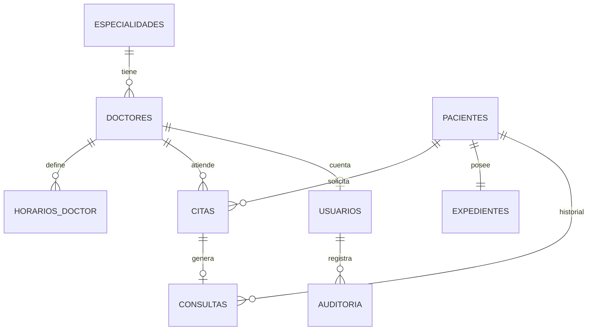

# Clínica Vida Plena — Sistema web de gestión de citas médicas

Proyecto del Grupo N°1 (Diseño Web · Redes · Programación).
Gestiona **citas médicas, registro de pacientes, expedientes médicos básicos y disponibilidad/horario de los doctores**.

**Stack:** Python 3 · Flask (API REST) · SQLite · HTML/CSS/JS puro (sin frameworks).

## Cómo ejecutarlo

```bash
pip install -r requirements.txt
python app.py            # abre http://127.0.0.1:5000
```
La base de datos `clinica.db` se crea sola con datos de ejemplo la primera vez. Para reiniciarla: `python seed.py`.

| Rol | Correo | Contraseña |
|---|---|---|
| Administrador | admin@vidaplena.hn | Admin123! |
| Recepción | recepcion@vidaplena.hn | Recep123! |
| Médico | doctor@vidaplena.hn | Doctor123! |

- Sitio público: `/` · Panel del personal: `/panel`

## Qué hace (y qué lo hace "no genérico")

**Sitio público**
- Catálogo de especialidades y equipo médico con los días que atiende cada doctor.
- **Agendador en 2 pasos con disponibilidad real**: calcula los espacios libres según el horario del doctor y las citas ya tomadas.
- **«Mi cita»**: al reservar, el paciente recibe un **código (VP-XXXXXX)**. Con el código + su identidad puede consultar, **cancelar o reprogramar** su cita (hasta 2 horas antes).
- **Identidad y teléfono de Honduras**: máscara `0000-0000-00000` al escribir, validación del departamento (01-18) y del año de nacimiento; teléfonos de 8 dígitos (fijos con 2, celulares con 3/8/9, admite +504).
- **Anti-abuso**: más de 3 intentos con la misma identidad en 30 s la bloquean 2 min (error 429 con cuenta regresiva); además hay límite por conexión y en el login.
- Secciones de **servicios y precios (L)**, seguros, testimonios, **ubicación con mapa**, botón de **WhatsApp** y datos de contacto editables en un solo lugar (`CLINICA` en `app.py`).
- **Orientador de síntomas**: sugiere la especialidad según lo que el paciente describe y avisa si parece una urgencia (motor de reglas; se puede reemplazar por una API de IA).

**Panel del personal (con roles)**
- *Resumen*: citas de hoy, pendientes, pacientes, gráfico por especialidad.
- *Citas*: filtros, confirmar/cancelar/no asistió, nueva cita con horas libres, registrar consulta.
- *Pacientes*: CRUD, búsqueda, expediente (tipo de sangre, alergias, crónicas, antecedentes) e historial de consultas.
- *Doctores*: CRUD, duración de cita y editor del horario semanal.
- *Calendario*: vista semanal por doctor; al tocar una cita se ven los detalles y las acciones.
- **Recordatorio por WhatsApp**: botón «📲 Recordar» que abre `wa.me` con el mensaje de la cita ya escrito (sin API ni costo).
- **Receta y constancia médica** imprimibles / «Guardar como PDF» desde el historial de consultas (médico y admin).
- *Reportes* (solo admin): resumen por doctor y estado, exportable a **CSV/Excel** o imprimible.
- *Auditoría* (solo admin): bitácora de accesos, expedientes consultados/editados, cambios de citas y reportes.

| Permiso | Admin | Recepción | Médico |
|---|:-:|:-:|:-:|
| Citas (crear / cambiar estado) | ✔ | ✔ | solo ve las suyas |
| Pacientes (crear / editar) | ✔ | ✔ | solo consulta |
| Historial clínico | ✔ | ✘ (privacidad) | ✔ |
| Doctores y horarios | ✔ | consulta | consulta |

## Asistente virtual

Botón de chat en el sitio público. Responde al instante sobre horarios, doctores por especialidad, próximas horas libres, cómo agendar y qué llevar, y orienta según los síntomas. Es **híbrido**: si hay una clave `ANTHROPIC_API_KEY`, un modelo de lenguaje (Claude) conversa usando datos reales de la clínica (doctores, días y próximas horas libres) y reglas estrictas (sin diagnósticos ni medicamentos); si no hay clave, no hay saldo o falla la conexión, responde el **asistente por reglas** (palabras clave sin importar tildes), que siempre funciona. Las emergencias se detectan siempre por reglas, antes de llamar a la IA. Código en `app.py` (`chat()`) y `static/js/chat.js`. Para ampliarlo basta agregar condiciones o palabras en `SINTOMAS`.

## Base de datos (15 %)


- 9 tablas de negocio en 3FN (más `limites` y `bloqueos`, técnicas, para el control de intentos), llaves foráneas, `CHECK` para estados/roles/horas y **índice único parcial** `(doctor, fecha, hora)` que impide a nivel de base de datos dos citas activas en el mismo horario.
- Script completo en `schema.sql`.

## API REST (25 %)

| Método y ruta | Descripción |
|---|---|
| `POST /api/login`, `/api/logout`, `GET /api/me` | Sesión |
| `GET /api/publico/especialidades`, `/doctores` | Catálogo público |
| `GET /api/doctores/<id>/disponibilidad?fecha=` | Horas libres |
| `POST /api/publico/citas` | Cita desde la web (crea paciente si no existe) |
| `POST /api/publico/sintomas` | Orientación por síntomas |
| `POST /api/publico/chat` | Asistente virtual (preguntas frecuentes, doctores y horas libres) |
| `POST /api/publico/mi-cita`, `/mi-cita/cancelar`, `/mi-cita/reprogramar` | Consultar, cancelar o cambiar una cita con código + identidad |
| `GET /api/publico/proximas` | Primera hora libre de cada doctor (sección «Próximas horas libres») |
| `GET/POST /api/pacientes`, `GET/PUT/DELETE /api/pacientes/<id>` | Pacientes |
| `GET/PUT /api/pacientes/<id>/expediente`, `POST …/consultas` | Expediente e historial |
| `GET/POST /api/doctores`, `PUT/DELETE /api/doctores/<id>`, `PUT …/horario` | Doctores |
| `GET/POST /api/citas`, `PATCH/DELETE /api/citas/<id>` | Citas |
| `GET /api/dashboard` | Estadísticas |
| `GET /api/citas?desde=&hasta=` | Citas por rango (calendario semanal) |
| `GET /api/reportes/resumen`, `/api/reportes/citas.csv` | Reportes (solo admin) |
| `GET /api/auditoria` | Bitácora (solo admin) |
| `GET /documento/receta/<id>`, `/documento/constancia/<id>` | Documento imprimible de una consulta |

Seguridad: límite de intentos (login, identidad, «Mi cita», reservas), bitácora de auditoría, CSV protegido contra inyección de fórmulas, contraseñas con hash (Werkzeug), consultas SQL parametrizadas (sin inyección SQL), escape de HTML en el panel (sin XSS), validación en servidor, control de acceso por rol (401/403) y códigos HTTP correctos (400, 404, 409).

## Pruebas automáticas

```bash
python -m unittest discover -s tests -v      # 13 pruebas (también funcionan con pytest)
```
Cubren: validación de identidad/teléfono hondureños, doble agendado (409), bloqueo por identidad (429), bloqueo de login, flujo «Mi cita», permisos por rol, CSV, auditoría y recetas. Usan una base de datos temporal; no tocan `clinica.db`.

## Despliegue (20 %)

**Render.com (gratis)**: sube la carpeta a GitHub → New Web Service → Build: `pip install -r requirements.txt` → Start: `gunicorn app:app` → variable `SECRET_KEY` con un valor largo y aleatorio.
**PythonAnywhere**: sube los archivos, crea una web app Flask apuntando a `app.py`.
> Nota: en planes gratuitos el disco puede reiniciarse y SQLite perder datos. Para la defensa funciona perfecto; en producción real se usaría PostgreSQL/MySQL (el cambio se limita a `get_db()`).

### Variables de entorno

| Variable | Para qué sirve |
|---|---|
| `SECRET_KEY` | **Obligatoria en producción.** Firma las sesiones; use un valor largo y aleatorio. |
| `ADMIN_PASSWORD`, `RECEPCION_PASSWORD`, `DOCTOR_PASSWORD` | Contraseñas iniciales de las cuentas (si no se definen, se usan las de ejemplo de la tabla de arriba). Se aplican solo cuando la base de datos se crea vacía. |
| `DB_PATH` | Ruta del archivo SQLite (opcional). |
| `ANTHROPIC_API_KEY` | **Opcional.** Activa el modo IA del asistente virtual. Es un secreto: va solo en las variables de entorno, nunca en el código ni en GitHub. |
| `CLINICA_TEL`, `CLINICA_WHATSAPP` | Teléfono y WhatsApp (formato `504XXXXXXXX`) que se muestran en el sitio. |
| `CHAT_MODEL` / `CHAT_IA` | Modelo que usa el asistente (por defecto `claude-haiku-5-5`) / `0` para desactivar la IA. |

En Render la cookie de sesión se marca como `Secure` automáticamente (HTTPS). Las cuentas de prueba ya **no** se muestran en la pantalla de login.

## Guion rápido para la defensa
1. Sitio público → buscar un síntoma → agendar una cita (mostrar que las horas ocupadas desaparecen).
2. Entrar como **recepción** → confirmar la cita → ver que no hay acceso al historial clínico.
3. Entrar como **médico** → atender la cita → registrar consulta → verla en el expediente.
4. Entrar como **admin** → cambiar el horario de un doctor → verlo reflejado en el agendador.
5. Mostrar `schema.sql`, el diagrama ER y probar un doble agendado (error 409).

**Preguntas probables:** ¿por qué SQLite? (simple, sin servidor, ideal para el alcance) · ¿cómo evitan citas dobles? (validación + índice único parcial) · ¿cómo protegen datos clínicos? (roles + sesiones) · ¿qué mejorarían? (recordatorios por WhatsApp/SMS, PostgreSQL, recetas en PDF).


## Mapa del código (para la defensa individual)

| Si te piden explicar… | Archivo y función |
|---|---|
| Cómo se evitan citas dobles | `schema.sql` (índice `ux_cita_doctor_slot`) y `crear_cita()` / `slots_libres()` en `app.py` |
| Validación de identidad y teléfono de Honduras | `valid_identidad()`, `valid_tel()` en `app.py` |
| El bloqueo por intentos | `limitar()` y `espera_bloqueo()` en `app.py`; se usan en `login()`, `pub_cita()` y `_cita_del_paciente()` |
| El código de cita y «Mi cita» | `nuevo_codigo()`, `_cita_del_paciente()`, `mi_cita*()` en `app.py` y la sección «Mi cita» al final de `static/js/public.js` |
| Roles y permisos | decorador `login_required()` en `app.py` |
| Auditoría | `audit()` en `app.py`, tabla `auditoria` en `schema.sql`, vista `auditoria()` en `static/js/panel.js` |
| Calendario, reportes y WhatsApp | `calendario()`, `reportes()`, `waLink()` en `static/js/panel.js` |
| Receta/constancia | ruta `documento()` en `app.py` y `templates/documento.html` |

## Rúbrica del parcial: dónde se cumple cada punto

| Criterio | Evidencia en el proyecto |
|---|---|
| Diagrama ER y script de BD (10) | Diagrama de este README + `schema.sql` (se ejecuta solo al iniciar) |
| Repositorio GitHub compartido (5) | Subir la carpeta a GitHub; cada integrante debe tener **commits propios** |
| Endpoints CRUD (15) | Tabla «API REST»: pacientes, doctores, citas y expedientes |
| Login y validación en servidor (10) | `/api/login`, hash de contraseñas, límites de intentos, validaciones con 400/404/409/429 |
| Diseño responsivo (10) | `style.css` con puntos de corte móviles; revisar en celular antes de la defensa |
| JavaScript conectado a la API (10) | `public.js` y `panel.js` consumen la API con `fetch` |
| Despliegue en vivo (10) | Render/PythonAnywhere (ver sección Despliegue) |
| Exposición e individual (10) | Guion de defensa y «Mapa del código» |
